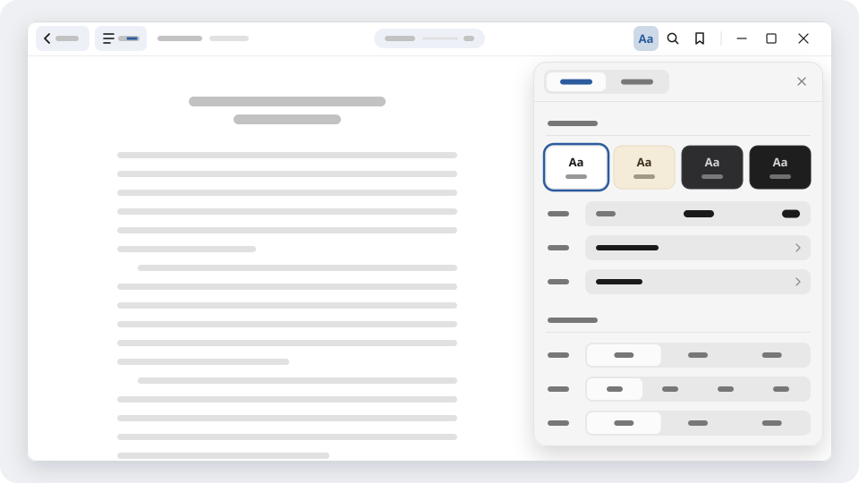

# SeLis

[](https://github.com/herenfor/epub-read/releases/latest)

[](LICENSE)

SeLis is a quiet, multi-format reader for Windows and Android. It opens **EPUB** books, **TXT** plain-text books and **CBZ / ZIP** image comics, and stays out of the way while you read.

Books are presented as their creators designed them: page width, asymmetric margins, floats, embedded fonts, illustrations and footnotes keep their own layout, while SeLis supplies sensible defaults only where a book leaves them unspecified.

<p align="center"></p>

**Languages:** English | [中文](README.zh.md)

## Contents

- [Platforms](#platforms)
- [Download and install](#download-and-install)
- [Highlights](#highlights)
- [Features](#features)
- [Privacy](#privacy)
- [Building from source](#building-from-source)
- [Linux troubleshooting](#linux-troubleshooting)
- [Roadmap](#roadmap)
- [Feedback](#feedback)
- [Contributors and thanks](#contributors-and-thanks)
- [License](#license)

## Platforms

| Platform | Requirements | Package |
| --- | --- | --- |
| Windows | Windows 10 / 11 (x64) | Installer (`.exe`) and portable build |
| Android | Android 7.0 or later (arm64) | `.apk` |

## Download and install

Every build is published on the [Releases](https://github.com/herenfor/epub-read/releases) page.

### Windows

Download the installer or the portable build. Windows 10 and 11 already include the required WebView2 runtime; older or trimmed-down systems may need to install the [evergreen WebView2 runtime](https://developer.microsoft.com/microsoft-edge/webview2/) first.

### Android

1. Download the `.apk` file on your phone or tablet.
2. Open it. Android asks you to allow installing unknown apps — enable it for the browser or file manager you used.
3. Once installed, **SeLis** appears on your home screen.

The app is not distributed through Google Play, so Play Protect may warn about an unrecognised app the first time; choose *More details → Install anyway*.

### Linux (experimental)

Linux is not part of the current released packages yet. The packaging candidates below build from source and are not official downloads:

- **Debian/Ubuntu `.deb` (candidate)**: a local test package has been built and opened on Debian 13 with software rendering and WebKitGTK 2.54. No official `.deb` is published, and the minimum distribution support is not established. Build it from source with the instructions below.
- **Flatpak (candidate)**: a source-built sandbox package, not submitted to Flathub. See [`packaging/flatpak/README.md`](packaging/flatpak/README.md). It opens books through the system file chooser/document portal and does not receive access to the whole home directory.
- **Arch Linux (AUR candidate)**: the `PKGBUILD` and build notes are in [`packaging/aur/`](packaging/aur/README.md), but the package has not been uploaded to the AUR. Build it only on Arch Linux from the pinned local source archive.

The first Linux scope is local reading. WebDAV sync and LAN transfer are not part of it. The deb was built on Ubuntu 26.04 and tested on Debian 13 with software rendering; file-manager association, native GPU/Wayland behavior and minimum older distributions are not yet verified. Do not install a Linux package from a third party claiming to be an official SeLis release.

### Updating

Open *Settings → About* to check for updates and view release notes directly inside the app:

- **Windows installer** downloads and verifies the update, then restarts into the installer.
- **Android** downloads and verifies the new `.apk`, then hands it to the system package installer.
- **Windows portable** links directly to the new build on the releases page.

Updating over an existing installation always keeps your library, reading progress, bookmarks and notes.

## Highlights

- **One reader for books and comics** — read EPUB 2 & 3 books, TXT novels and CBZ/ZIP comics with consistent navigation, progress tracking and shelf organisation
- **Read the way you prefer** — turn one page or a two-page spread, or scroll continuously from one chapter straight into the next, and switch at any time without losing your place
- **A quiet reading interface** — contents, bookmarks and notes share one drawer, up to five books stay open in tabs, and the rest of the interface stays out of sight until needed
- **Live typography that respects the book** — adjust themes, custom colours, font, size, line height, spacing, margins and columns from a compact `Aa` panel; sliders reflect the book's own defaults and reset to follow the book with one tap
- **Kind to every pair of eyes** — Traditional/Simplified Chinese conversion and custom character replacement, grayscale/invert/dim/saturation/sharpen filters, and assistance for red, green and blue colour weakness; all of them change only what is drawn on screen, never the file
- **Made for touch and desktop alike** — finger-following page turns, corner-tap bookmark ribbons and volume-key page turning on Android; a custom theme-matched title bar, multi-book tabs and keyboard/wheel navigation on Windows
- **Illustrations and footnotes in place** — click or tap an image to inspect, zoom and pan in an overlay; preview footnotes on hover or pin them to scroll without leaving your page
- **Organise without moving your files** — import individual files or entire directory trees into matching shelf folders, watch a folder for automatic imports, and choose whether books are read directly from their original location or copied into the library
- **A private shelf when you need one** — switch to a password-protected shelf whose books, progress, bookmarks and notes are stored separately and excluded from global search, LAN transfer and cloud sync
- **Local by default, connected when you choose** — transfer books and reading records directly between devices over local Wi‑Fi via QR code, or sync reading data (never book files) through your own WebDAV storage

<p align="center"></p>

<p align="center"></p>

## Features

### Formats

- **EPUB 2.0.1 and EPUB 3.x** — reflowable and fixed-layout (`pre-paginated`) books, embedded audio and video playback, right-to-left page progression, experimental vertical writing mode (with a force-horizontal toggle), consecutive single-image chapters paired into two-page spreads, and DRM detection notices
- **TXT text books** — automatic detection and manual selection for UTF-8, UTF-16 and common legacy encodings (including GB18030/GBK and Big5), automatic chapter recognition, paragraph indent switch and full justification, plus full support for typography, search, bookmarks and notes without modifying the source file
- **Image comics (`CBZ` / `ZIP`)** — natural page ordering, single-page or two-page spreads, continuous vertical scrolling that joins pages at their natural aspect ratio, `ComicInfo` right-to-left metadata support, pinch-to-zoom and whole-strip zoom in scroll mode, and windowed loading for large archives *(RAR/CBR, 7z and PDF are not included)*

### Library and storage

- **Flexible importing** — import from the file picker (single or batch), drag and drop onto the window on desktop, or open books directly from your system file manager with *Open with SeLis*
- **Folder & auto-import** — scan an entire directory and turn its sub-folders into shelf folders with a pre-import preview and cancellable progress; or set a watched folder in *Settings → Storage* to import new books automatically when the shelf is idle
- **Original files or library copies** — on both Windows and Android, choose whether to read books directly from their original paths or copy them into the app library; reconnect moved files when needed, relocate the Windows library folder, or export original book files from the shelf or any folder
- **Automatic duplicate detection** — the same book is recognised and never added twice
- **Shelf organisation** — cover grid and detailed list views, folders and favourites, per-folder independent sorting, whole-folder batch selection, generated placeholder covers and "new" badges
- **Private shelf** — unlock a separate, password-protected shelf from the shelf header; move books between the normal and private shelves at any time while keeping original files in place
- **Interface customisation** — switch interface language between Simplified Chinese, English and system default without restarting; choose light/dark appearance and full or reduced motion

### Reading

- **Paged and continuous modes** — turn one page or a two-page spread at a time, or scroll continuously across chapters, remembered per book; in two-page mode, half-empty chapter endings can pair with the opening page of the next chapter, and page turns slide smoothly across chapter boundaries
- **Multi-book tabs** — keep up to five books open in tabs and switch between them without losing your reading position
- **Live `Aa` typography panel** — four built-in page themes (Light, Sepia, Gray, Night) plus up to six custom colour themes (paper, text and accent); live sliders for font size, line height, font weight, letter/word/paragraph spacing, margins and columns that default to the book's own styles and reset with one tap; optional override for book-declared fonts
- **Interruptible page-turn motion** — slide, fade or instant page turns; touch drags follow your finger and can be reversed mid-turn, and tap zones can be customised with a visual preview (including left-side tap for next page)
- **Visual bookmark ribbons** — hang a ribbon on the current page from the toolbar or by tapping the top page corner on touch screens (left and right corners manage their respective pages in two-page mode), with quick undo on removal
- **Navigation and jump history** — contents, bookmarks and notes share a single drawer with collapsible branches; jumping via the progress bar, table of contents, links, search results, bookmarks or notes records a history you can step back and forth through
- **Notes and search** — select text to copy or attach a note; edit, delete or jump back to notes at any time; search inside the current book or across the entire library (with a rebuildable full-text index)
- **Illustrations and footnotes** — open any in-text illustration in an overlay to zoom, pan, fit to window or view at original size; preview footnotes on hover on desktop or pin them in a scrollable popover
- **Character display and visual filters** — Traditional/Simplified Chinese conversion and custom replacement rules (while search and *Copy original* still use the book's underlying text); grayscale, invert, dim, saturation and sharpen filters with a press-and-hold original comparison button; adjustable red, green and blue colour-weakness assistance

### Sync, transfer and backup

- **LAN device transfer** — pair two devices on the same Wi‑Fi by scanning a QR code or pasting a connection code; send reading progress, bookmarks and notes (optionally with the book files), transfer multiple batches in one session, and switch sending direction on the fly
- **WebDAV cloud sync** — optionally connect Nutstore (坚果云) or any compatible WebDAV service to sync reading progress, bookmarks, notes, favourites and folder assignments across devices; book files are never uploaded, and when multiple devices have progress for the same book you can choose which device's position to continue from
- **Portable reading archives** — export and import `.epubsave` archives to carry progress, bookmarks, notes and safe settings between devices

### Per platform

- **Windows** — custom theme-aware title bar housing book tabs and window controls; reveal book files directly in File Explorer; configurable library directory with guided migration; in-app update download and installation
- **Android** — edge-to-edge immersive reading with optional system status bar hiding, keep-screen-on toggle, battery indicator, volume-key page turning (with long-press continuous turning and direction swap), built-in QR scanner for device transfer, and step-by-step system back gesture support

### Compatibility

Book files in the wild vary widely, and SeLis is built to handle them gracefully:

- Percentages, asymmetric margins, floats and book-embedded fonts keep their intended proportions and faces
- Wide text tables wrap cleanly without overflowing the column, while pre-formatted tables stay intact
- Full-page illustrations, single-image SVG covers, divider graphics and inline footnote markers render at their proper aspect ratios
- Long chapters are prepared in the background so opening a book or entering a heavy chapter never blocks the page you are reading

## Privacy

SeLis requires no account by default and collects no analytics or telemetry. Your books, notes and reading progress stay on your device.

- **Private shelf** data is stored in an isolated local repository protected by your password and is never included in library-wide search, LAN transfer or WebDAV sync.
- **WebDAV sync** is strictly opt-in and only syncs reading metadata (progress, bookmarks, notes, favourites and folders) to the WebDAV server you configure — book files are never uploaded.
- **Device transfer** connects your two devices directly over your local network using an encrypted, one-time pairing; nothing passes through an external server. On Android, camera permission is requested only when you scan a pairing QR code.

## Building from source

You need [Node.js](https://nodejs.org/), [pnpm](https://pnpm.io/), [Rust](https://www.rust-lang.org/) and the [Tauri 2 prerequisites](https://v2.tauri.app/start/prerequisites/).

```bash
pnpm install
pnpm tauri:dev:core      # run the desktop app in development mode
pnpm test                # run the test suite
```

- Windows installer: run `pnpm build:windows` in PowerShell
- Android package: run `scripts/build-android.sh build` on Linux or WSL with the Android SDK, NDK and a JDK installed (the environment variables it reads are listed at the top of the script)

### Linux

Install the GTK 3, WebKitGTK 4.1 and Fontconfig development packages (for example `libgtk-3-dev`, `libwebkit2gtk-4.1-dev` and the matching Fontconfig development package — `libfontconfig1-dev` or `libfontconfig-dev` — on Debian/Ubuntu; `gtk3`, `webkit2gtk-4.1` and `fontconfig` on Arch), plus [Node.js](https://nodejs.org/), [pnpm](https://pnpm.io/) and [Rust](https://www.rust-lang.org/).

```bash
pnpm install --frozen-lockfile
bash scripts/build-linux.sh --no-bundle      # standalone binary
bash scripts/build-linux.sh --bundles deb    # local Debian package
```

The entry sets `VITE_APP_PLATFORM=linux`, writes the frontend to `dist/core-linux`, and puts the binary under `src-tauri/target/linux-core/release/`. The deb packaging lives in [`src-tauri/tauri.linux-core.conf.json`](src-tauri/tauri.linux-core.conf.json) with the desktop template in [`src-tauri/linux/`](src-tauri/linux/); the Flatpak and AUR candidates are documented in [`packaging/flatpak/README.md`](packaging/flatpak/README.md) and [`packaging/aur/README.md`](packaging/aur/README.md).

## Linux troubleshooting

- **GTK/WebKitGTK development packages**: if the build stops with `Install the GTK 3, WebKitGTK 4.1 and Fontconfig development packages for your distribution.`, install the packages above and check `pkg-config --modversion webkit2gtk-4.1`. Do not force-install packages built for another distribution.
- **CJK fonts**: if Chinese text appears as empty boxes, install a system CJK font (`fonts-noto-cjk` on Debian/Ubuntu, `noto-fonts-cjk` on Arch) and restart the app. SeLis uses system fonts and does not bundle Windows fonts.
- **Blank window or stopped web process**: keep the terminal output and copy diagnostics from *Shelf → Settings → About → Diagnostic Log* → *Copy diagnostics*. The copy contains the app version and edition, platform, architecture, package channel, WebKitGTK version, Linux session type and compatibility mode; it does not contain books, paths, credentials or log text. Include the distribution, desktop session (X11/Wayland), WebKitGTK version and GPU details. Do not disable the WebKit sandbox, turn off hardware acceleration or delete the library as a first workaround; these are not established fixes.
- **Flatpak file access**: if a host path is rejected, choose the book through the file chooser/document portal. Do not grant whole-home access to work around it. Keep the original portal error in the report.
- **Downloads/build failures**: retry the same `pnpm install` or Cargo command. Reuse the existing local cache or a trusted mirror/proxy configured in the tool; do not replace the build with an unknown prebuilt package. AUR builds are supported on Arch only.

## Roadmap

- Semantic search that understands meaning, not only exact words
- AI-assisted questions and answers grounded in the book, with citations back to the original text
- Chapter and book summaries
- macOS, Linux and iOS builds

## Feedback

Bugs and suggestions are welcome in [Issues](https://github.com/herenfor/epub-read/issues) — every one of them gets read. Please include your platform and the app version (shown under *Settings → About*), and the book title if the problem only happens with one book.

## Contributors and thanks

- [mcss1314](https://github.com/mcss1314) — **Primary tester**, for ongoing release testing, reproducing bugs, and providing detailed feedback and suggestions.

## License

Copyright © 2026 HeRenFor.

Original code in SeLis is licensed under the [GNU General Public License v3.0 (`GPL-3.0-only`)](LICENSE).

- You are free to run, study, modify, and redistribute the software under the terms of the GPL-3.0. Any distributed modified versions or derivative works incorporating SeLis code must also be distributed as a whole under the GPL-3.0 with complete corresponding source code.
- The license does **not** grant rights to use the **SeLis** name, application icons, or official application identifiers (`dev.epubreader.app`, `dev.epubreader.ai`, `dev.herenfor.epubreader`) to endorse or impersonate official releases; redistributed modified builds must use distinct branding and identifiers.
- Third-party components remain subject to their respective licenses (MIT, Apache-2.0, MPL-2.0, BSD, ISC, Zlib, Unicode-3.0, and others); full lists, copyright notices, license texts, and source locations are in [THIRD_PARTY_LICENSES.md](THIRD_PARTY_LICENSES.md).

For brand rules, contribution terms, alternative licensing inquiries, and historical release license boundaries (`v0.2.2` and earlier under Apache-2.0; `v0.2.3`–`v0.3.11` under PolyForm Strict 1.0.0), see [LICENSING.md](LICENSING.md).
